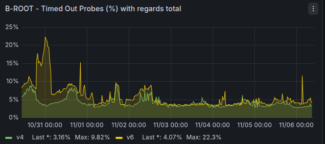
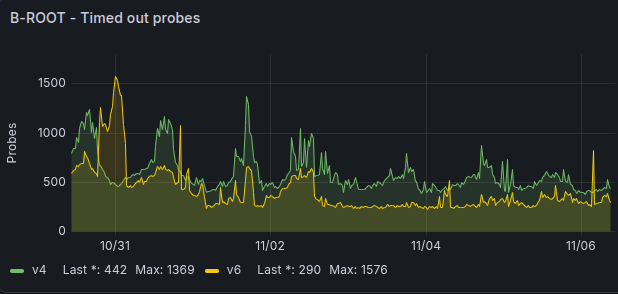
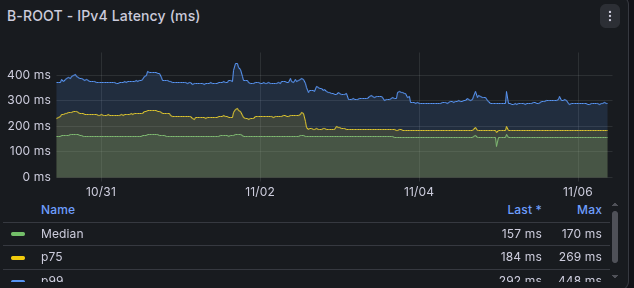
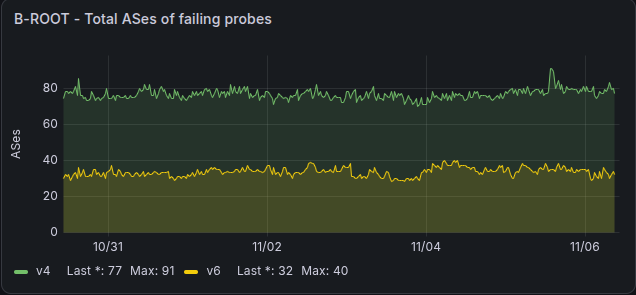
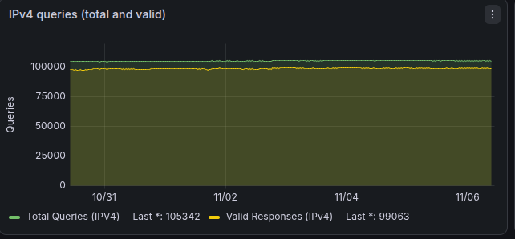
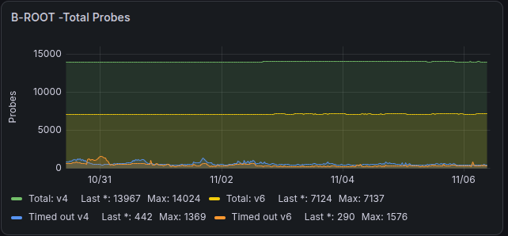
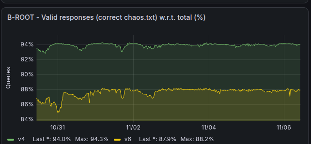

# Rootviz API Guide

The Rootviz API provides measurements for the root-server instances A through M. This guide describes the available measurement families and how to request them. 

This API exposes the data shown  on the RootViz dashboard ([https://rootviz.sidnlabs.nl](https://rootviz.sidnlabs.nl))

## Root-server instances and RIPE Atlas measurements

Letters A–M identify `a.root-servers.net` through `m.root-servers.net`.

Each instance has separate IPv4 and IPv6 RIPE Atlas measurements. RootViz **agreggrate** these measurements in 30min bins.

The IDs below come from the [RootViz measurement ID file](root_measurement_ids.json), also available in the [upstream repository](https://github.com/SIDN/rootviz/blob/main/root_measurement_ids.json).

<details>
<summary>RIPE Atlas measurement IDs</summary>

| Letter | IPv4 measurement | IPv6 measurement |
| --- | --- | --- |
| A | [10309](https://atlas.ripe.net/measurements/10309) | [11309](https://atlas.ripe.net/measurements/11309) |
| B | [10310](https://atlas.ripe.net/measurements/10310) | [11310](https://atlas.ripe.net/measurements/11310) |
| C | [10311](https://atlas.ripe.net/measurements/10311) | [11311](https://atlas.ripe.net/measurements/11311) |
| D | [10312](https://atlas.ripe.net/measurements/10312) | [11312](https://atlas.ripe.net/measurements/11312) |
| E | [10313](https://atlas.ripe.net/measurements/10313) | [11313](https://atlas.ripe.net/measurements/11313) |
| F | [10304](https://atlas.ripe.net/measurements/10304) | [11304](https://atlas.ripe.net/measurements/11304) |
| G | [10314](https://atlas.ripe.net/measurements/10314) | [11314](https://atlas.ripe.net/measurements/11314) |
| H | [10315](https://atlas.ripe.net/measurements/10315) | [11315](https://atlas.ripe.net/measurements/11315) |
| I | [10305](https://atlas.ripe.net/measurements/10305) | [11305](https://atlas.ripe.net/measurements/11305) |
| J | [10316](https://atlas.ripe.net/measurements/10316) | [11316](https://atlas.ripe.net/measurements/11316) |
| K | [10301](https://atlas.ripe.net/measurements/10301) | [11301](https://atlas.ripe.net/measurements/11301) |
| L | [10308](https://atlas.ripe.net/measurements/10308) | [11308](https://atlas.ripe.net/measurements/11308) |
| M | [10306](https://atlas.ripe.net/measurements/10306) | [11306](https://atlas.ripe.net/measurements/11306) |

</details>

Use the instance letter in a metric selector. For example, `B_p99_rtt_rcode0_correct_chaos` requests the P99 RTT measurement for instance B.


## Data source and aggregation

The published measurements are aggregated from raw RIPE Atlas DNS measurements. Every 30 minutes, more than 10,000 probes send a `CHAOS TXT hostname.bind` query directly to each Root Server instance, bypassing recursive resolvers.

For timeout-related results, processing inspects each measurement result and counts unique probe IDs that reported a timeout within each 30-minute time bin. Results are grouped by Root Server instance and IP version. RIPE Atlas describes the [measurement result format](https://atlas.ripe.net/docs/apis/measurement-result-format#version-5000).


## Production URL

The production base URL is `https://api.rootviz.sidnlabs.nl`.

FastAPI's interactive documentation is served on the same HTTPS host and port:

- Swagger UI: `https://api.rootviz.sidnlabs.nl/docs`
- ReDoc: `https://api.rootviz.sidnlabs.nl/redoc`
- OpenAPI JSON: `https://api.rootviz.sidnlabs.nl/openapi.json`

## Authentication

Include the API key issued to you in the `X-API-Key` request header. Keep it secret and do not commit it to source control. To request an API key, contact `sidnlabs@sidn.nl`.

## Terms of use

The API is provided free of charge, on a best-effort basis, "as is" and without warranty of any kind. SIDN does not guarantee availability, accuracy or completeness of the data, and there is no service level agreement. We may change, rate-limit or withdraw the API, and revoke API keys, at any time. SIDN is not liable for any damage resulting from the use of the API or the data. Data obtained through the API is licensed under [CC BY 4.0](https://creativecommons.org/licenses/by/4.0/): cite SIDN Labs and RootViz, and credit RIPE NCC and the RIPE Atlas probe hosts.

## Endpoint

### `GET /metrics`

Returns time-series data for one or more requested metrics. Each series includes labels such as the protocol (`v4` or `v6`) and timestamp/value samples.

#### Query parameters

| Name | Required | Default | Description |
| --- | --- | --- | --- |
| `start` | Yes | | Range start as a timezone-aware ISO-8601 datetime, such as `2026-11-05T10:00:00Z`. |
| `end` | Yes | | Range end as a timezone-aware ISO-8601 datetime. Must be after `start`. |
| `step` | No | `1800` | Sampling interval in seconds. Minimum is 1800 seconds (30 minutes). |
| `metric` | No | All supported metrics | Metric selector; repeat the parameter to request multiple metrics. |

The maximum range is currently one day. To retrieve a week, make seven daily requests. Align start and end to the 30-minute sampling boundaries where possible. Adjacent ranges may include the same boundary sample; deduplicate by timestamp and labels when combining responses.

#### Metric selectors

Use a letter from A through M followed by one of these selectors:

- `median_rtt_rcode0_correct_chaos`
- `p75_rtt_rcode0_correct_chaos`
- `p99_rtt_rcode0_correct_chaos`
- `failed_asns_valid_probes`
- `other_rcode_queries`
- `timeout_probes`
- `total_probes`
- `total_queries`
- `valid_probes_failed_no_error`
- `valid_probes_with_errors_timeout_etc`
- `valid_rcode0_queries_with_correct_chaos`
- `ratio_timeout`


#### Requesting data

Use the production endpoint `https://api.rootviz.sidnlabs.nl/metrics` with an issued API key. The API accepts timezone-aware start and end timestamps, with a minimum 30-minute sampling interval. The current maximum range is one day; request a week as seven separate daily ranges. Responses include protocol labels (`v4` and `v6`).

For example, to request several B measurements, pass the `metric` parameter once per selector:

```bash
curl -G 'https://api.rootviz.sidnlabs.nl/metrics' \
  -H 'X-API-Key: <your-issued-api-key>' \
  --data-urlencode 'start=2026-11-05T10:00:00Z' \
  --data-urlencode 'end=2026-11-05T11:00:00Z' \
  --data-urlencode 'step=1800' \
  --data-urlencode 'metric=B_timeout_probes' \
  --data-urlencode 'metric=B_total_probes' \
  --data-urlencode 'metric=B_ratio_timeout'
```


The JSON response contains `status` and `data`. `data.result` is a list of series; each series includes labels and a `values` list of `[Unix timestamp, string value]` samples. An empty `data.result` means the request succeeded but there were no samples for the selected metrics and evaluation times.

#### HTTP errors

| Status | Meaning |
| --- | --- |
| `401` | Missing or invalid API key. |
| `422` | Invalid selector, timezone-naive timestamps, invalid range, or `step` below 1800 seconds. |
| `429` | Rate limit exceeded. Check the `Retry-After` header. |
| `502` | The upstream data request failed. |

The default rate limit is 10 requests per minute per key. Limits are held in memory per API process and reset on restart; clients may also be throttled by the service's edge controls.


## Metrics Description

The graph examples below use B-ROOT (`b.root-servers.net`). Replace `B` with any letter from A through M to select another Root Server instance. The API returns both IPv4 and IPv6 series; where noted, a figure is an IPv4-only dashboard view. 

These graphs are extracted from [B-ROOT dashboard](https://rootviz.sidnlabs.nl/public-dashboards/0577a947e6f74a4791e2e8f5ed643cd6?from=2026-10-30T11:07:40.604Z&to=2026-11-06T11:07:40.604Z&refresh=15m&timezone=utc) at RootViz.

### Graph 1: Timeout percentage

Selectors: `B_timeout_probes` and `B_total_probes`

Calculation: `100 * B_timeout_probes / B_total_probes`, for both IPv4 and IPv6 in the same graph.

Description / units: _Add approved definition and units._



### Graph 2: Timed-out probes

Selector: `B_timeout_probes`

Description / units: absolute number of probes that timeout 



### Graph 3: RTT percentiles

Selectors: `B_median_rtt_rcode0_correct_chaos`, `B_p75_rtt_rcode0_correct_chaos`, and `B_p99_rtt_rcode0_correct_chaos`

The median, P75, and P99 measurements use the same population and are shown together in one graph. We shown only for IPv4 below, but the data has both labels. 

Description / calculation / units: _Add the shared RTT computation and units._



### Graph 4: Failed ASNs with valid probes

Selector: `B_failed_asns_valid_probes`

Description / calculation / units: _Add approved definition._



### Graph 5: Total and valid RCODE 0 queries

Selectors: `B_total_queries` and `B_valid_rcode0_queries_with_correct_chaos`

The dashboard has separate IPv4 and IPv6 graphs. This example figure shows IPv4; API responses include both protocols.

Description / calculation / units: _Add approved definition._



### Graph 6: Total and timed-out probes

Selectors: `B_total_probes` and `B_timeout_probes`

Both IPv4 and IPv6 are shown together in the graph.

Description / calculation / units: _Add approved definition._



### Graph 7: Valid RCODE 0 query percentage

Selectors: `B_valid_rcode0_queries_with_correct_chaos` and `B_total_queries`

Calculation: `100 * B_valid_rcode0_queries_with_correct_chaos / B_total_queries`.

Description / units: _Add approved definition and units._




## Metric names and definitions

The API selector is the internal Grafana/OTLP metric name with the prefix removed and the Root Server letter in its place:

| Where | Name format | Example |
| --- | --- | --- |
| API (`metric` parameter) | `<LETTER>_<suffix>` | `B_timeout_probes` |
| Exported gauge (see [METRICS.md](METRICS.md#5-exported-grafana-metrics)) | `<grafana_metric_prefix>_<service>_<suffix>` | `<prefix>_b_timeout_probes` |

The `<suffix>` is identical in both. The API drops `<grafana_metric_prefix>` and uses the upper-case instance letter (A–M) as the service. The `protocol` label (`v4` or `v6`) is the same in both.

The full definition of each metric (which rows are counted, filters, RTT percentiles, ASN classification, caveats) is in [METRICS.md](METRICS.md). Use this table to find the matching section:

| API selector suffix | Underlying aggregated JSON field | Details |
| --- | --- | --- |
| `total_queries` | `total_queries` | [METRICS.md §4](METRICS.md#4-aggregated-json-fields) |
| `total_probes` | `total_probes` | [§4](METRICS.md#4-aggregated-json-fields) |
| `valid_rcode0_queries_with_correct_chaos` | `valid_queries_rcode0_with_correct_chaos` | [§4](METRICS.md#4-aggregated-json-fields) |
| `other_rcode_queries` | sum of `rcode_counts` except `"0"` | [§5](METRICS.md#5-exported-grafana-metrics) |
| `timeout_probes` | `failed_probes_timeout_but_stack_works` | [§3](METRICS.md#3-row-sets-used-by-the-metrics), [§4](METRICS.md#4-aggregated-json-fields) |
| `valid_probes_with_errors_timeout_etc` | `failed_probes_error` | [§4](METRICS.md#4-aggregated-json-fields) |
| `valid_probes_failed_no_error` | `failed_probes_valid` | [§3](METRICS.md#3-row-sets-used-by-the-metrics) |
| `median_rtt_rcode0_correct_chaos` | `rtt_rcode0_correct_chaos.p50` | [Percentiles](METRICS.md#percentiles) |
| `p75_rtt_rcode0_correct_chaos` | `rtt_rcode0_correct_chaos.p75` | [Percentiles](METRICS.md#percentiles) |
| `p99_rtt_rcode0_correct_chaos` | `rtt_rcode0_correct_chaos.p99` | [Percentiles](METRICS.md#percentiles) |
| `failed_asns_valid_probes` | `asn_failed_probes_classification_len` | [ASN classification](METRICS.md#asn-classification) |
| `ratio_timeout` | derived: `100 × timeout_probes / total_probes` | see below |

`ratio_timeout` is not one of the exported gauges in METRICS.md; it is a percentage computed per protocol from `timeout_probes` and `total_probes`, and is undefined when `total_probes` is zero.

Things to keep in mind when using the data (details in [METRICS.md §6](METRICS.md#6-caveats)):

- `total_queries` counts all results, while the other counts only include probes whose IP stack works. Do not divide stack-filtered counts by `total_queries` without care.
- Some metrics count results (queries) and others count distinct probes.
- A probe can appear in both valid and failed counts in the same 30-minute window.
- Probe metadata (ASN, country, IP-stack tags) comes from a daily snapshot.
