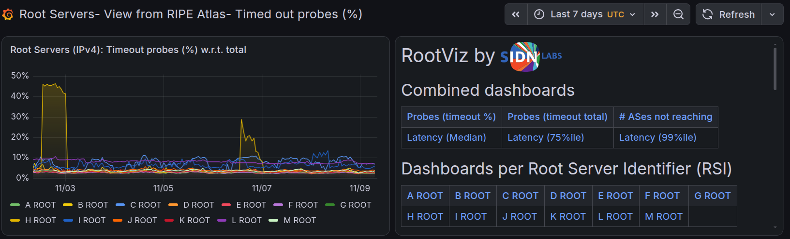
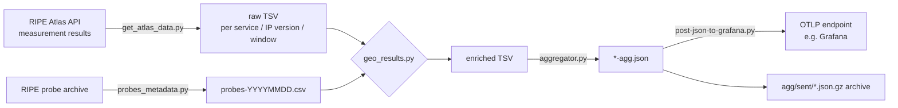

# rootviz

> [!TIP]
> **See it live at [rootviz.sidnlabs.nl](https://rootviz.sidnlabs.nl)**: real-time health of all 13 DNS root servers, as seen by RIPE Atlas probes worldwide.
> This repository contains the backend that powers it.

[](https://rootviz.sidnlabs.nl)

Monitor the reachability, latency and integrity of anycast DNS services (such as
the root servers or your own authoritative name servers) from thousands of
vantage points, using [RIPE Atlas](https://atlas.ripe.net/) measurements.

Every 30 minutes rootviz downloads the `hostname.bind CHAOS TXT` answers that
RIPE Atlas probes received from your service, then:

- **validates** each answer against the identity strings your servers really return,
  so you can tell when something between the probe and your service answers in its place
  (interception, hijacking, middleboxes),
- **enriches** results with each probe's ASN, country, continent and IPv4/IPv6 health,
- **aggregates** each window into a JSON summary: query and probe counts, RCODEs, errors,
  RTT percentiles (overall, per continent and per country), and a classification of failing probes,
- **exports** the key numbers as OTLP metrics, for example to Grafana.

📏 **Exactly how every metric is computed is documented in [METRICS.md](METRICS.md).**

## How it works



rootviz is a **batch job, not a server**. It listens on no port and is never
reachable from the internet. It only makes outbound HTTPS requests: to RIPE
Atlas for data, and to your metrics endpoint to push results. The public
dashboard at [rootviz.sidnlabs.nl](https://rootviz.sidnlabs.nl) is served by
Grafana, which only receives the exported metrics.

`run_all_scripts.py` runs the five stages in order. Each stage is also a standalone script.

| Stage | What it does |
|-------|--------------|
| `get_atlas_data.py` | Fetches every complete 30-minute window for each configured measurement (IPv4 and IPv6). Missed windows are backfilled (up to `max_catchup_windows`) using `chaos_state.json`. A window is only marked done once it was fetched successfully. |
| `probes_metadata.py` | Downloads the daily RIPE Atlas probe archive (today, falling back two days) and keeps ASN, country and tags. Old files are removed after `days_to_keep` days. |
| `geo_results.py` | Adds `asn`, `country`, `continent`, `v4_works`, `v6_works` and `chaos_valid` to each raw file, in place. |
| `aggregator.py` | Writes `<file>-agg.json` per window and, by default, deletes the enriched TSV. |
| `post-json-to-grafana.py` | Sends one OTLP payload per service and window. Files are gzipped into `agg/sent/` **only after a successful POST**; failed sends are retried on the next run. |

## Requirements

- Python 3.9 or newer
- Outbound HTTPS to `atlas.ripe.net` and `ftp.ripe.net`
- Optional: an OTLP/HTTP metrics endpoint (Grafana Cloud, Grafana Alloy, an OpenTelemetry Collector, …)

No RIPE Atlas account or credits are needed to *read* results of public measurements.

## Quick start

```bash
git clone https://github.com/SIDN/rootviz.git
cd rootviz
python3 -m venv .venv && . .venv/bin/activate
pip install -r requirements.txt

python run_all_scripts.py
```

The included `config.yaml` monitors the 13 root server letters through RIPE
Atlas's built-in measurements, so the first run produces data straight away:

```bash
ls results/agg/
# chaos_A__IPv4_20260219_1200_1230-agg.json  chaos_A__IPv6_20260219_1200_1230-agg.json  ...
python -m json.tool results/agg/chaos_K__IPv4_*-agg.json | head -40
```

Without a `grafana_url` the export stage is skipped, and the JSON files stay in `results/agg/`.

## Monitoring your own service

1. **Find or create two RIPE Atlas DNS measurements** (one IPv4, one IPv6) that query
   your service for `hostname.bind` in class `CHAOS`, type `TXT`. When you
   [create a measurement](https://atlas.ripe.net/measurements/form/) choose
   type *DNS*, query class *CHAOS*, query type *TXT*, query argument
   `hostname.bind` and your service's address as the target. Creating
   measurements costs Atlas credits. Note the measurement IDs.

2. **Find out what your servers answer:**

   ```bash
   dig @ns1.example.net hostname.bind CH TXT +short
   "ams1.ns1.example.net"
   ```

3. **Add the service to `config.yaml`:**

   ```yaml
   measurements:
     ns1.example.net:
       ipv4: 12345678
       ipv6: 12345679
       regex: "^[a-z]{3}[0-9]+\\.ns1\\.example\\.net$"
       chaos_string: "ams1.ns1.example.net,fra2.ns1.example.net"   # documentation / fallback
   ```

   - `regex` is a Python regular expression, applied with `re.match`: it is
     anchored at the start, so add `$` to anchor the end.
   - If you set no `regex`, `chaos_string` is used as an exact-match allow-list (comma-separated).
   - The service name becomes part of file and metric names. Use only letters,
     digits, dots and dashes, and never two underscores in a row.

4. Run `python run_all_scripts.py`.

## Running continuously

Run the pipeline from cron shortly after each half hour. The pipeline holds a
lock file, so a slow run (for example during API retries) won't overlap with
the next one.

```cron
# m   h  dom mon dow  command
5,35  *  *   *   *    ROOTVIZ_CONFIG=/opt/rootviz/config.yaml GRAFANA_API_KEY=xxxx /opt/rootviz/.venv/bin/python /opt/rootviz/run_all_scripts.py >> /var/log/rootviz.log 2>&1
```

`run_all_scripts.py` changes into the directory that holds the config file, so
relative paths in `config.yaml` resolve there. It exits non-zero when a stage
fails.

## Configuration

All settings live in `config.yaml`. Values can reference other top-level
values with `${name}`, for example `agg_output_dir: "${save_dir}/agg"`.
Set `ROOTVIZ_CONFIG` to use a config file somewhere else.

| Key | Default | Description |
|-----|---------|-------------|
| `scripts` | the five stages | Stages run by `run_all_scripts.py`, in order |
| `base_path` | the scripts' directory | Where the stage scripts live |
| `lock_file` | `.rootviz.lock` | Lock that prevents overlapping runs |
| `logging_level` | `INFO` | `DEBUG`, `INFO`, `WARNING`, `ERROR` |
| `save_dir` | `./results` | Raw and enriched TSV files |
| `probes_dir` | `probes` | Probe metadata CSVs |
| `agg_input_dir` | `./results` | Aggregator input |
| `agg_output_dir` | `./results/agg` | Aggregator output |
| `grafana_input_dir` | `./results/agg` | Exporter input |
| `state_file` | `chaos_state.json` | Last fetched window per measurement |
| `log_file` | none | Extra log file for the downloader |
| `api_base` | `https://atlas.ripe.net/api/v2/measurements` | RIPE Atlas API |
| `batch_secs` | `1800` | Window length in seconds |
| `max_workers` | `4` | Parallel downloads |
| `max_catchup_windows` | `48` | How many missed windows to backfill |
| `retry_delays` | `[60, 180, 540, 900]` | Wait (s) before each retry of a failed download |
| `request_timeout` | `90` | HTTP timeout (s) for Atlas requests |
| `measurements` | none | Services to monitor (see above) |
| `days_to_keep` | `5` | Age (days) after which probe CSVs are deleted |
| `agg_delete_input` | `true` | Delete the enriched TSV after aggregating |
| `agg_local_rtt_ms` | `5` | Failed answers faster than this count as "maybe hijack" |
| `grafana_url` | none (export off) | OTLP/HTTP metrics endpoint |
| `grafana_metric_prefix` | `rootviz` | Metric name prefix |
| `grafana_delay_between_posts` | `0` | Pause (s) between POSTs |
| `grafana_timeout` | `30` | HTTP timeout (s) for the exporter |
| `grafana_incomplete_max_age_hours` | `6` | After this long, send a window even if its IPv4 or IPv6 file is missing |

**Secrets** are read from the environment only. If `GRAFANA_API_KEY` is set,
it is sent as `Authorization: Bearer <key>`. To test the endpoint, run
`GRAFANA_API_KEY=... python grafana-works.py`.

## Output

The tables below are a quick reference. For the exact definition of every
field and metric (which rows are counted, filters and caveats) see
**[METRICS.md](METRICS.md)**.

### Raw and enriched files

Files are named `chaos_<service>__<IPv4|IPv6>_<YYYYMMDD>_<HHMM>_<HHMM>.tsv`
(UTC, window start and end). Columns:

| Column | Description |
|--------|-------------|
| `prb_id` | RIPE Atlas probe ID |
| `timestamp` | Unix time of the query |
| `src_addr` | Probe's source address as seen by Atlas (may be NATed) |
| `rt` | Response time in ms |
| `rdata` | First CHAOS TXT string in the answer |
| `rcode` | DNS response code (empty if there was no response) |
| `error_type` | Atlas error, for example `timeout` (empty if there was a response) |
| `asn`, `country`, `continent`, `tags` | From probe metadata *(added by enrichment)* |
| `v4_works`, `v6_works` | `false` if Atlas tags the probe as having a broken IPv4/IPv6 stack *(enrichment)* |
| `chaos_valid` | Whether `rdata` matches the service's `regex` *(enrichment)* |

### Aggregated JSON

Unless stated otherwise, counts include only probes whose IP stack for the
measured protocol works (`v4_works`/`v6_works`).

| Field | Meaning |
|-------|---------|
| `timestamp` | Window start (Unix time) |
| `total_queries` | All results in the window (no stack filter) |
| `total_probes`, `total_addresses` | Distinct probes / source addresses |
| `rcode_counts` | Results per RCODE; `"null"` = no DNS response |
| `error_counts` | Results per Atlas error type |
| `valid_queries_rcode0_with_correct_chaos` | NOERROR answers with a valid CHAOS string |
| `valid_probe_ids_…`, `valid_addresses_…` | Distinct probes / addresses with such answers |
| `hijack_rcode0_wrong_chaos` | NOERROR answers whose CHAOS string does **not** match: likely answered by someone else |
| `rtt_rcode0_correct_chaos` | p25/p50/p75/p99 RTT (ms) of valid answers |
| `rtt_rcode0_correct_cahos_per_cont`, `rtt_rcode0_correct_chaos_per_country` | The same, per continent / country code (the misspelled key is kept for compatibility) |
| `failed_probes_valid` | Non-NOERROR answers from routable sources, slower than `agg_local_rtt_ms` |
| `failed_probes_maybe_hijack` | Non-NOERROR answers faster than `agg_local_rtt_ms` (probably a local resolver) |
| `failed_probes_invalid` | Failures from non-routable source addresses |
| `failed_probes_error` | Distinct probes with an Atlas error (timeout, socket, …) |
| `failed_probes_timeout_but_stack_works` | Distinct probes that timed out although their IP stack works |
| `asn_failed_probes_classification` | Per ASN with timing-out probes: `{"<asn>": {"timed_out": [prb_ids], "working": [other prb_ids with valid answers]}}` |
| `asn_failed_probes_classification_len` | Number of those ASNs with an empty `working` list (no other probe got a valid answer) |

### Exported metrics

Each metric is a gauge named `<prefix>_<service>_<suffix>`, with one data point
per protocol (attribute `protocol` = `v4` or `v6`).

| Suffix | Source field |
|--------|--------------|
| `total_queries` | `total_queries` |
| `total_probes` | `total_probes` |
| `valid_rcode0_queries_with_correct_chaos` | `valid_queries_rcode0_with_correct_chaos` |
| `other_rcode_queries` | Results without RCODE 0, including no response |
| `timeout_probes` | `failed_probes_timeout_but_stack_works` |
| `valid_probes_with_errors_timeout_etc` | `failed_probes_error` |
| `valid_probes_failed_no_error` | `failed_probes_valid` |
| `median_rtt_rcode0_correct_chaos`, `p75_…`, `p99_…` | RTT percentiles (ms) |
| `failed_asns_valid_probes` | `asn_failed_probes_classification_len` |

## API access

In addition to the public dashboard, SIDN Labs offers a hosted API to query
the underlying metrics directly (authenticated, rate-limited). See
**[API.md](API.md)** for the endpoint, authentication and request/response
details. The API service itself is closed-source; this repository is only
the data pipeline that feeds it.

## Testing

```bash
pip install pytest
python -m pytest tests
```

## Troubleshooting

- **No files appear in `results/`.** Check that the measurement exists and is
  running: `curl https://atlas.ripe.net/api/v2/measurements/<id>/`. Then look
  at the downloader log (`log_file`). After a failed download, the window is
  retried on the next run.
- **Everything is `chaos_valid = false`.** Look at the real answers with
  `cut -f5 results/chaos_*.tsv | sort | uniq -c | sort -rn | head`, and test
  your regex: `python -c "import re; print(re.match(r'^nnn1-', 'nnn1-ams'))"`.
- **Files stay un-enriched.** `geo_results.py` needs a probe file in
  `probes_dir`. Run `python probes_metadata.py` and check that it can reach
  `ftp.ripe.net`.
- **JSON files pile up in `results/agg/`.** Either the export is failing (the
  log shows the HTTP status) or one protocol's file is missing for a window.
  Such windows are sent anyway after `grafana_incomplete_max_age_hours`.

## Known issues in historical data

The following bugs affected data produced **before 9 November 2026**, including
the history shown on [rootviz.sidnlabs.nl](https://rootviz.sidnlabs.nl). They are
fixed in the current code; older data points were not recomputed.

- **ASNs not reaching a root server were undercounted**
  (`asn_failed_probes_classification_len`, metric `failed_asns_valid_probes`).
  To decide whether "other probes in the same ASN still work", the old code
  counted result *rows* instead of distinct *probes*. Atlas probes query several
  times per window, so a single working probe, or even the failing probe itself,
  was enough to label an ASN as "other probes work". The current code counts
  distinct probes and excludes the probes that failed, so values from this date
  on are somewhat higher.
- **Valid answers containing `nan` were counted as hijacks.** A CHAOS answer
  containing the letters `nan` (for example `…-nanog…`) was treated as missing,
  which raised `hijack_rcode0_wrong_chaos` and lowered the valid-query counts.
- **Probes in Namibia were missing from per-country/continent statistics.**
  Their country code `NA` was read as "not available".
- **IPv4/IPv6 filter not applied to some failed probes.** Probes with a known
  broken IPv4/IPv6 stack were still included in `failed_probes_maybe_hijack` and
  `failed_probes_valid` when they received a non-zero RCODE.
- **RTT metrics were truncated to whole milliseconds** when exported. They are
  now sent with decimals.

## Data and attribution

This tool uses data from [RIPE Atlas](https://atlas.ripe.net/). If you publish
results, follow the [RIPE Atlas terms and conditions](https://www.ripe.net/about-us/legal/ripe-atlas-service-terms-and-conditions/)
and credit RIPE NCC and the RIPE Atlas probe hosts.

## Issues and contributions

Source code: <https://github.com/SIDN/rootviz>. Please report bugs and ask
questions in [GitHub issues](https://github.com/SIDN/rootviz/issues). Pull
requests are welcome.

## License

MIT. See [LICENSE](LICENSE). Developed at [SIDN Labs](https://www.sidnlabs.nl/).
